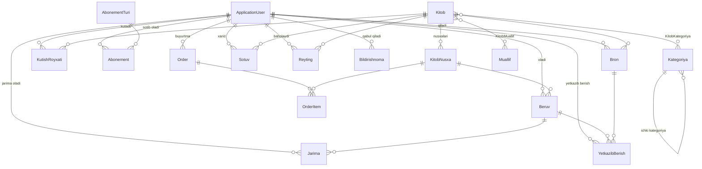

# KutubxonaAt — Kutubxona boshqaruv tizimi

Kutubxona faoliyatini avtomatlashtirish uchun **ASP.NET Core MVC (.NET 9)** da yozilgan veb-ilova: kitoblar katalogi, ijara (berish/qaytarish), bron, jarimalar, kutish ro'yxati, abonementlar, elektron kitoblarni sotib olish va admin panel.

> **Jamoaviy loyiha.** Bu loyiha universitet bitiruv malakaviy ishi doirasida jamoada bajarilgan.
> **Mening hissam:** _[Shu yerga o'zingiz qilgan qismlarni yozing. Masalan: ijara va jarima moduli, bron va kutish ro'yxati, ma'lumotlar bazasi dizayni, Admin panel...]_

## Imkoniyatlar

**Foydalanuvchi (User)**
- Kitoblar katalogi: qidiruv, filtrlash, sahifalash (ro'yxatdan o'tmagan ham ko'ra oladi)
- Kitobni bron qilish; nusxa bo'lmasa avtomatik **kutish ro'yxatiga** qo'shilish va nusxa bo'shaganda bildirishnoma
- Ijaralarni ko'rish, **uzaytirish** (maksimum 3 marta), qaytarish va ijara tarixi
- Muddati o'tganda avtomatik **jarima** (1000 so'm/kun) va jarimalar ro'yxati
- Abonement turlari, savat, elektron kitoblarni sotib olish va "Raqamli kutubxona"
- Yetkazib berish buyurtmasi va kuzatuv
- Profil, parolni o'zgartirish, bildirishnomalar

**Admin / Kutubxonachi (Admin, Librarian)**
- Kitoblar, mualliflar, kategoriyalar, kitob nusxalari (inventar raqami bilan) CRUD
- Foydalanuvchilarni boshqarish, kitob berish/qabul qilish, bronlardan berish
- Jarimalar, xaridlar, yetkazib berish, abonement turlari boshqaruvi
- Dashboard statistikasi, hisobotlar (umumiy, foydalanuvchilar, moliyaviy)
- Aloqa formasi orqali kelgan xabarlar

**Biznes qoidalar (avtomatik berish servisi):** foydalanuvchi faol bo'lishi, to'lanmagan jarima bo'lmasligi, bir vaqtda 5 tadan ko'p kitob olmasligi tekshiriladi; ijara muddati 30 kun.

## Texnologiyalar

| Qatlam | Texnologiya |
|---|---|
| Backend | C#, ASP.NET Core MVC (.NET 9), Areas (Admin / User) |
| Ma'lumotlar bazasi | SQL Server, Entity Framework Core 9 (Code First, migratsiyalar) |
| Autentifikatsiya | ASP.NET Core Identity, rollar: Admin, Librarian, User |
| Frontend | Razor Views, Bootstrap, JavaScript |
| Boshqa | Session (savat), `DocumentFormat.OpenXml`, Docker / docker-compose |

## Arxitektura

```
KutubxonaAt/
├── Areas/
│   ├── Admin/        # Admin panel: Controllers + Views
│   └── User/         # Foydalanuvchi bo'limi: Controllers + Views
├── Controllers/      # Umumiy: Home, Account (login/register)
├── Data/             # ApplicationDbContext, DbInitializer (demo ma'lumotlar)
├── Models/           # Entity'lar va ViewModel'lar
├── Services/         # AutoBerishService, BildirishnomaService, LibraryRules
├── Migrations/       # EF Core migratsiyalari
└── wwwroot/          # Statik fayllar
```

## ER-diagramma (asosiy bog'lanishlar)



## Ishga tushirish

### 1-usul: Docker (tavsiya etiladi, istalgan tizimda)

Talab: Docker Desktop.

```bash
cp .env.example .env        # fayl ichidagi parollarni o'zgartiring
docker compose up --build
```

Ilova: <http://localhost:8080>. Birinchi ishga tushishda baza avtomatik yaratiladi (migratsiyalar) va demo ma'lumotlar yuklanadi.

### 2-usul: Lokal (Windows + SQL Server LocalDB)

Talab: .NET 9 SDK, SQL Server LocalDB (Visual Studio bilan birga o'rnatiladi).

- **Visual Studio:** `KutubxonaAt.sln` ni oching (papkani emas, aynan `.sln` faylni), yuqoridagi profilni **http** qilib **F5** bosing.
- **Windows:** `Run.bat` ga ikki marta bosing (yoki terminalda `dotnet run --launch-profile http`).

Ilova <http://localhost:5030> da ochiladi. Ishga tushganda migratsiyalar avtomatik qo'llanadi, Development muhitida demo ma'lumotlar ham yuklanadi.

Lokal sinash uchun admin paroli `appsettings.Development.json` da yozilgan (`Admin123!`). **Bu faqat lokal demo uchun**: serverga joylashda parolni `user-secrets` yoki environment (`AdminSettings__Password`) orqali o'zgartiring.

### Hisoblar

| Rol | Login | Parol |
|---|---|---|
| Admin | `admin@kutubxona.uz` | lokal: `Admin123!` (Docker: `.env` dagi `ADMIN_PASSWORD`) |
| Kutubxonachi (demo) | `librarian@kutubxona.uz` | `Librarian@2025!` |
| Foydalanuvchi (demo) | `ali.karimov@student.uz` | `User@2025!` |

Demo hisoblar faqat namunaviy ma'lumotlar (`SeedDemoData`) yoqilganda yaratiladi. **Haqiqiy muhitda `SeedDemoData=false` qoldiring.**

## Ekran rasmlari

_Rasmlarni `docs/screenshots/` papkasiga qo'shing va shu yerga ulang:_

<!--


-->

## Xavfsizlik bo'yicha eslatmalar

- Production maxfiy ma'lumotlari (admin paroli, DB paroli) repoda saqlanmaydi: `user-secrets` yoki environment o'zgaruvchilari orqali beriladi (`appsettings.Development.json` dagi parol faqat lokal demo uchun)
- POST amallarida `[ValidateAntiForgeryToken]`, rollarga asoslangan `[Authorize]`
- Parolni tiklash tokeni faqat Development muhitida to'g'ridan-to'g'ri ko'rsatiladi; productionda email xizmati ulanishi kerak (hozircha ulanmagan)

## Rivojlantirish rejasi

- [ ] Holatlarni (`"Berilgan"`, `"Qaytarilgan"` ...) `enum` ga o'tkazish
- [ ] Ijara mantiqini controllerlardan `LoanService` ga ko'chirish
- [ ] Bir vaqtda oxirgi nusxani olishda concurrency himoyasi (`RowVersion`)
- [ ] `DateTime.Now` → `DateTime.UtcNow`
- [ ] xUnit testlar (ijara va jarima qoidalari)
- [ ] Email orqali parolni tiklash
- [ ] REST API qatlami (JWT + Swagger)
- [ ] GitHub Actions (build + test)
